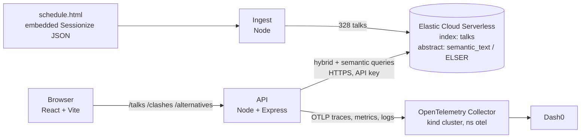

# Conference Clash Resolver

Star the KubeCon + CloudNativeCon North America 2026 talks you want to see. The app finds the ones
that overlap, and for any clashing talk suggests the most similar talks that **don't** clash with
the rest of your picks. One click swaps them.

Built at the WeMakeDevs Cloud Native Hackathon, November 9, 2026.

## What it does

KubeCon NA 2026 has 328 sessions over four days. On Tuesday at 11:30 alone, 16 talks start at
once. Most attendees star whatever looks interesting and only find out on the day that two or three
of their picks overlap. The official schedule shows the overlap but doesn't help you fix it.

- **Browse and search** all four days. Search is hybrid: it finds exact names (a speaker, "Velero")
  and meaning ("backing up persistent volumes" finds the Velero and Longhorn talks).
- **Star talks.** Picks stay in your browser, with no account or login.
- **See clashes** side by side as soon as two starred talks overlap.
- **Find alternatives** for a clashing talk: the five most similar talks by abstract that don't
  overlap anything else you've starred. Optional audience-level filter (Beginner / Any Level /
  Advanced) and an Inclusion + Accessibility boost.
- **Swap** in one click. The clash clears.
- Times always show in conference time (Mountain Time), whatever your device is set to.

## Demo

> **https://drive.google.com/file/d/1Wgi0hC7WIKzVfJLLxekUGyKGELVxpvNw/view?usp=sharing**

The demo path: pick **Tue** → star *Your Agent Needs a Platform* and *Ask Your Platform* (both 11:30)
→ the clash appears → **Find alternatives** on *Ask Your Platform* → **Swap** for *Platform
Engineering after the AI Hype* (12:20) → the clash clears → open the `GET /alternatives` trace and the
Site Health dashboard in Dash0.

## How it works



| Part | What it does | Code |
|---|---|---|
| **Ingest** | Pulls the JSON the official schedule page embeds, keeps the 328 talks in the allowlisted tracks that run 90 minutes or less, pins every time to `-07:00`, strips HTML from abstracts, and bulk-loads the `talks` index. | `ingest/index.js` |
| **API** | `GET /talks` browses a day or runs hybrid search. `POST /clashes` returns every overlapping pair of starred talks. `GET /alternatives` runs the similar-talk query. | `api/server.js` |
| **Web** | One page: day picker and search, talk cards with stars, the clash panel, alternatives with Swap. Has a mock mode that runs entirely from `contract/examples`. | `web/src/` |
| **Contract** | The index mapping, an example response for every endpoint, and the rules JSON can't express. Every part was built against it. | `contract/` |
| **Telemetry** | OpenTelemetry for the API, loaded before the app starts, so the app code didn't change. | `api/instrumentation.js` |
| **Infra** | kind + Collector (`up.sh`), the Dash0 dashboard as code (`dash0/`), and Kubernetes manifests for the app (`k8s/`). | `infra/` |

**Two talks clash** when `a.start < b.end && b.start < a.end`. Strict comparisons mean back-to-back
talks don't clash.

## How it's built

### Elasticsearch: the core data layer
Elastic Cloud Serverless is the only datastore. `abstract` is a `semantic_text` field on ELSER
(`.elser-2-elastic`), so Elasticsearch generates the embeddings itself and the app has no embedding code.

- **Hybrid search** (`/talks?q=`): an **RRF** retriever fuses two rankings:
  - **Keyword:** `multi_match` on `title^3, speakers^2, tags`.
  - **Semantic:** an ELSER match on `abstract`.

  RRF fuses rank positions, so the two very different score scales don't fight. On the semantic side,
  `min_score: 6` drops noise. That value comes from measurement: real queries scored 8–20 and nonsense
  5 or less. A nonsense query returns nothing, and a speaker's surname still finds their talk.
- **Alternatives** (`/alternatives`): one query does the whole job.
  - **`must`:** a semantic query using the clashing talk's full abstract as the query text.
  - **`must_not`:** excludes the talks you've starred, plus **one time-range clause per other starred
    talk**, so a suggestion can never create a new clash.
  - **Options:** an optional `level` filter, and a `should` boost for the Inclusion + Accessibility
    track. It's a boost rather than a filter, because the track has only 14 talks.

### Dash0: observability
The API sends OTLP to a Collector in the kind cluster, which forwards to Dash0. The API never holds
the Dash0 token.

- **Traces:**
  - **Automatic:** HTTP, Express, Elasticsearch client and outgoing HTTP spans. One `/alternatives`
    request is one trace, from the incoming request down to the Elasticsearch searches.
  - **Product attributes on the request span:** `talks.count`, `search.query`, `clashes.count`,
    `starred.count`, `alternatives.count`, and the level and accessibility filters.
- **Logs:** one structured access log per request. Severity follows the status code, and each record
  carries the trace ID, so logs and traces link both ways. `console.*` output and Node warnings become
  log records too.
- **Metrics:** request duration into and out of the API, plus Node event-loop delay and utilization,
  and heap usage. In Kubernetes, every signal is tagged with namespace, deployment and pod.
- **Dashboard:** *Clash Resolver: Site Health* (13 panels: traffic, 5xx rate, latency by route,
  Elasticsearch latency, Node runtime), kept as code in `infra/dash0/`.

### Gitar: every change through a reviewed PR
Each feature landed as its own pull request, and Gitar reviewed each one. The repo has project-specific
Gitar setup:
- **`.gitar/review/instructions.md`:** our blocking checks:
  - drift from the API contract;
  - every timestamp keeping its `-07:00` offset;
  - overlap checks using `<`, not `<=`;
  - alternatives excluding starred and clashing talks;
  - folder ownership;
  - no secrets in code.
- **`.gitar/rules/`:** `contract-guard` and `smoke-test-evidence`.

Findings that led to fixes:
- [#11](https://github.com/xd-dbug/cnh-hackathon/pull/11): flush telemetry on SIGINT.
- [#15](https://github.com/xd-dbug/cnh-hackathon/pull/15): don't put raw URLs into `http.route`.
- [#13](https://github.com/xd-dbug/cnh-hackathon/pull/13): "top 50", not a misleading total.

### Kubernetes
A local **kind** cluster runs the OpenTelemetry Collector (namespace `otel`). The app can run there too
(namespace `clash`): `infra/k8s/deploy.sh` builds the api and web images, loads them into kind, and
deploys them. nginx serves the web build and proxies `/api` to the api Service.

## Run it locally

**You need:** Node 20+, Docker, kind, kubectl and helm, an Elastic Cloud project with an API key, and
a Dash0 account.

1. **Secrets live outside the repo.** Put them in an env directory (default `/home/xd/hackathon-env`;
   override with `CNH_ENV_DIR`):
   - `dash0.env`: `DASH0_ENDPOINT`, `DASH0_AUTH_TOKEN` (read by `up.sh` and `infra/dash0/apply.sh`)
   - `.env`: `ES_URL`, `ES_API_KEY`, `OTEL_EXPORTER_OTLP_ENDPOINT=http://localhost:4318`

   Then link the app's env file into the checkout: `ln -s "$CNH_ENV_DIR/.env" .env`
2. **Infrastructure:** `infra/up.sh` creates the kind cluster and the Collector.
3. **Install and load data:** `npm install`, then `npm run ingest`. This loads 328 talks and prints
   the per-day counts and a sample document.
4. **Run it:** `npm run dev:api` (port 3001) and `npm run dev:web` (http://localhost:5173).
   - Without Elasticsearch: `VITE_USE_MOCKS=true npm run dev:web` runs the UI from `contract/examples`.
5. **Optional:**
   - `infra/dash0/apply.sh` creates or updates the Dash0 dashboard.
   - `infra/k8s/deploy.sh` runs the app in kind; open it with
     `kubectl -n clash port-forward svc/web 8080:80`.

## Repository layout

```text
contract/   mapping.json, examples/*.json, README.md (rules): the source of truth
ingest/     schedule.html → talks index
api/        Express API; instrumentation.js = OpenTelemetry
web/        React (Vite) app
infra/      kind config, Collector values, up.sh, dash0/ (dashboard), k8s/ (app manifests)
.gitar/     Gitar review instructions and repository rules
CLAUDE.md   project rules every agent follows
```

## Known limitations

- **Re-running ingest drops search briefly:** ingest deletes and recreates the `talks` index, so search
  is down for a few seconds during a re-run.
- **The accessibility boost is small** next to ELSER scores, and the level filter drops talks that have
  no level (the Maintainer Track).
- **No real-user monitoring in the web app, no SLO, and no CI.**
- **In kind, the app is reached through `kubectl port-forward`.** There's no Ingress.

## AI use

This project was built with **Claude Code**. I (Damian Swiney) set the plan and the project rules,
defined the contract (index mapping and API rules) and the original infrastructure, and reviewed and
merged every pull request. Claude Code wrote the application code through role-specific subagents,
each limited to its own folder (rules in `CLAUDE.md` and `.claude/agents/`):
- Agent A: ingest
- Agent B: the API
- Agent C: the web app
- Agent T: the OpenTelemetry setup

The agents built in parallel against the shared `contract/`, and each opened its own PR, which Gitar
reviewed before I merged it. A coordinating Claude Code session ran the environment checks, generated
the contract's example files from the real schedule data, drafted the Kubernetes, Dash0 and docs
changes, and checked the agents' work against the live system.
